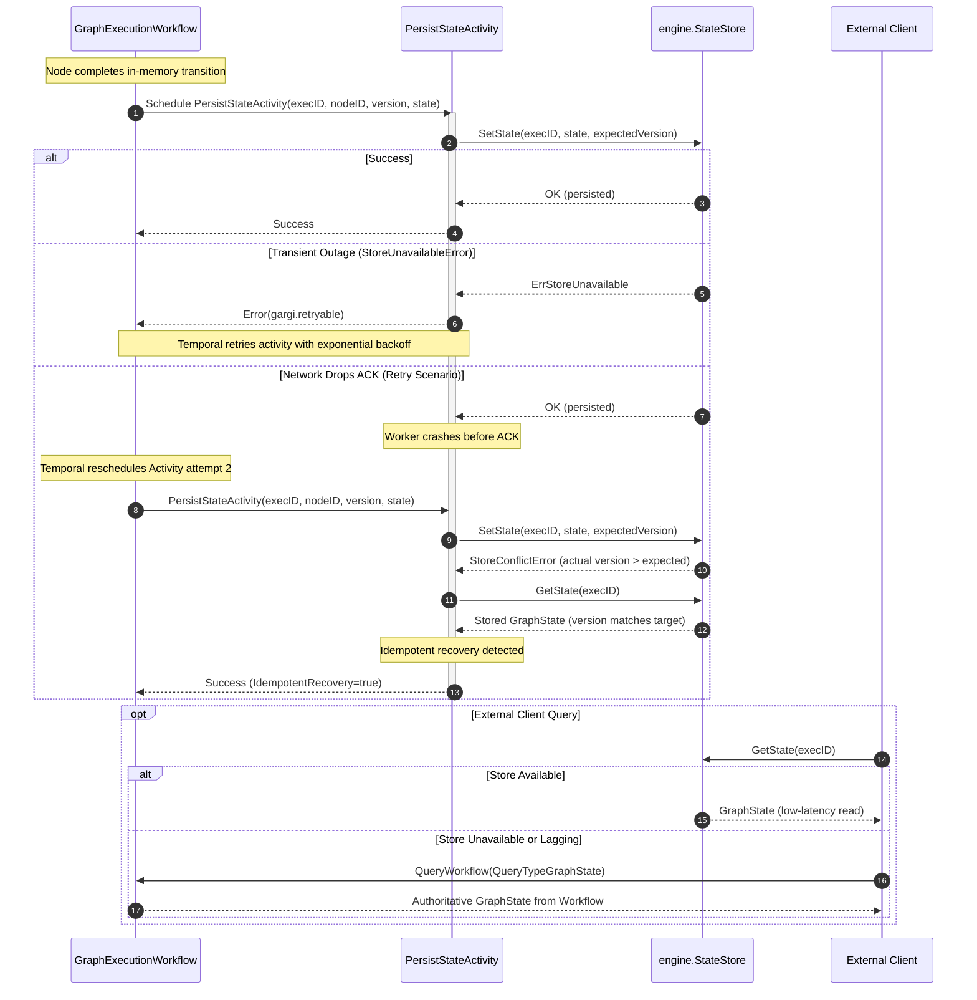

# Temporal and StateStore Consistency Model

## Status
Accepted

## Date
2026-10-19

## Context
Gargi CKG executes reactive knowledge graph workflows using Temporal as the distributed orchestration engine. Workflows manage execution state across arbitrary DAG topologies, tracking node transitions, inputs, outputs, compensation records, and reactive event subscriptions.

Issue #40 defined the `engine.StateStore` abstraction along with distributed locking (`LockManager`), audit logging (`ExecutionLog`), and event publishing (`EventPublisher`) interfaces. As part of Epic #39 (Pluggable State Storage Adapters), the system supports external storage backends (such as Redis, PostgreSQL, or DynamoDB) to enable low-latency point-in-time reads, live state dashboards, and reactive graph querying outside the Temporal cluster.

However, introducing an external state store alongside Temporal creates classic distributed systems dual-write and consistency challenges:
- **Temporal Determinism & Replay:** Temporal workflow definitions must be deterministic and pure functions of their event history. Performing state store mutations directly within workflow code would violate determinism, create duplicate mutations during event replay, and break workflow recoverability.
- **Authoritative Source of Truth:** If an external store and Temporal event history diverge (e.g., due to network partitions, activity timeouts, or partial writes), the system must have an unambiguous, single source of truth.
- **Activity Retries & At-Least-Once Delivery:** Temporal activities execute with at-least-once semantics. An activity that successfully persists state to the external store but fails to acknowledge completion before its heartbeat or start-to-close timeout will be retried by Temporal. The state persistence mechanism must be strictly idempotent to prevent corrupting monotonic state versions.
- **Read Path Scalability vs. Freshness:** High-throughput external consumers (e.g., query APIs, monitoring dashboards, downstream agents) require fast state reads without hammering Temporal frontend servers or triggering heavy history decodes. At the same time, callers need graceful degradation when the external store is lagging, unconfigured, or experiencing downtime.

## Decision

We establish the following consistency and interaction model between Temporal workflows and `engine.StateStore`:

### 1. Temporal History as Authoritative Source of Truth
- The Temporal workflow execution history is the **authoritative, durable, and immutable source of truth** for all graph executions.
- `engine.GraphState` snapshots and node transition logs within workflow execution history govern graph lifecycle decisions (scheduling, routing, saga compensations, and termination).
- The external `engine.StateStore` is an **eventually consistent materialized projection (read-model)** of the workflow execution history, optimized for low-latency external queries and reactive event streaming.

### 2. Asynchronous Activity-Driven Write-Through
- **No Direct Workflow Mutations:** Workflow definitions *never* invoke `engine.StateStore` directly. All external state persistence occurs exclusively inside dedicated Temporal activities (`PersistStateActivity` / `WriteStateActivity` on `StateActivities`).
- **Orchestration Decoupling:** Graph execution advances through deterministic in-memory state transitions (`GraphState.Apply`). As transitions occur, state-persistence activities are dispatched asynchronously or at node completion boundaries. If an external store is temporarily slow, workflow logic remains isolated from backend storage latencies.

### 3. Idempotency Keying and Optimistic Concurrency Control (CAS)
- **Canonical Idempotency Key:** Every state write activity is keyed by the tuple:
  ```
  (ExecutionID, NodeID, Version)
  ```
  where `Version` is the expected monotonic version of `GraphState`.
- **Compare-And-Swap (CAS) Writes:** The activity invokes `store.SetState(ctx, execID, state, expectedVersion)` or `store.PatchState(ctx, execID, mutation, expectedVersion)`. Storage adapters enforce CAS: if the stored version does not match `expectedVersion`, a `StoreConflictError` is returned.
- **Idempotent Retry Protocol:**
  When Temporal retries an activity following an unacknowledged execution (or during duplicate replay):
  1. The activity attempts the CAS write against `expectedVersion`.
  2. If the store returns `StoreConflictError`, the activity queries the current stored state using `store.GetState(ctx, execID)`.
  3. **Duplicate Re-execution Detection:** If `storedState.Version >= targetVersion` (where `targetVersion` is the expected version with the state/mutation already applied) and the node state transition has already been committed to the store, the activity recognizes that a previous attempt succeeded. It logs the idempotent recovery and **succeeds cleanly without error**.
  4. **True Conflict Detection:** If `storedState.Version < targetVersion` or the stored state reflects an incompatible divergent transition from an unexpected writer, the conflict is deemed unrecoverable. The activity returns a non-retryable Temporal application error (`gargi.non_retryable`), halting futile retries.

### 4. Reading Semantics & Multi-Tier Fallback Hierarchy
External clients (APIs, query services, operators) observe state through a tiered read model:
1. **Tier 1 (Fast Path):** Query `engine.StateStore.GetState(ctx, execID)`. Delivers sub-millisecond to low-millisecond responses without touching the Temporal cluster.
2. **Tier 2 (Authoritative Fallback):** If `StateStore` is not configured (`nil`), returns `StoreNotFoundError` (e.g., initial replication lag), or returns `StoreUnavailableError` (backend outage), the client falls back to querying the running Temporal workflow directly via `client.QueryWorkflow(ctx, workflowID, runID, "graph_state")` (or `FetchStateWithFallback`).
3. **Completed Executions:** If both the store and the running workflow query are unavailable, the client retrieves the execution result from Temporal workflow history (`WorkflowRun.Get`).

### 5. Error Classification and Store Unavailable Semantics
Per ADR-0003:
- **`StoreUnavailableError` (and network/context timeouts):** Classified as `ClassRetryable` (`gargi.retryable`). Temporal activity retry policies automatically retry the persistence activity with exponential backoff (`InitialInterval = 1s`, `BackoffCoefficient = 2.0`, `MaximumInterval = 100s`). The workflow does not fail prematurely due to transient network hiccups.
- **`StoreConflictError` (unrecoverable):** Classified as `ClassNonRetryable` (`gargi.non_retryable`). Temporal does not retry true version conflicts.
- **Unconfigured / Nil `StateStore`:** Treated as a graceful no-op (`IdempotentNoop = true`), allowing lightweight embedded, in-memory, or Temporal-only deployments without external infrastructure dependencies.



## Consequences

- **Positive:**
  - **Replay Safety:** Workflows remain 100% deterministic; replay never triggers redundant external store writes.
  - **No Dual-Write Split-Brain:** Temporal history is always the definitive ground truth; the external store is an idempotent projection.
  - **Safe At-Least-Once Retries:** Retried state persistence activities cannot overwrite newer state or fail on duplicate attempts.
  - **Low Latency & High Read Scalability:** High-volume read traffic is offloaded to the pluggable `StateStore`, preserving Temporal cluster resources.
  - **Operational Resilience:** Transient storage outages are absorbed by Temporal activity retries with exponential backoff; unconfigured stores degrade gracefully to no-ops.
- **Negative:**
  - **Eventual Consistency Lag:** There is a minimal scheduling and activity execution window during which `StateStore` may briefly lag behind the latest workflow transition. Clients requiring strict real-time freshness must query the workflow directly.
  - **Activity Overhead:** State persistence activities incur Temporal activity scheduling and history event overhead.

## Alternatives

- **Direct StateStore writes within Workflow Definition:**
  *Rejected.* Violates Temporal strict determinism requirements. Any workflow replay (due to worker deployment or server recovery) would re-execute the store writes, causing concurrency conflicts and side effects.
- **Transactional Outbox via Database CDC:**
  *Rejected.* Would require coupling Temporal state with an external relational database transaction or Debezium CDC pipeline, introducing unnecessary architectural complexity. Temporal activities natively provide reliable, retried outbox semantics.
- **StateStore as Authoritative Source of Truth (Temporal as secondary executor):**
  *Rejected.* Breaks Temporal built-in event-sourced architecture and makes saga compensations, signal replay, and deterministic fault tolerance significantly harder to guarantee.
