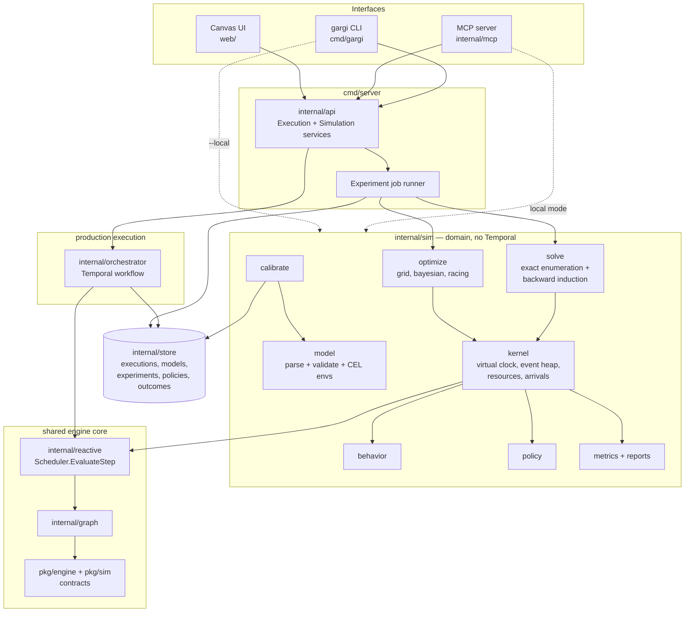

# gargi-flow Simulation — Product Architecture

> Status: **Draft / proposal.** Nothing here is implemented yet. It extends the
> existing engine ([SPEC.md](../SPEC.md)) and follows ADR-0002 package boundaries.
> The P0 slice (mode A kernel, exhaustive search, exact and Monte Carlo
> evaluators, `gargi model validate` / `gargi sim run --local`) is implemented;
> see the [simulation quickstart](quickstart.md) to run it.

## 1. What we are building

A system where a decision process is modelled once as a graph, then:

1. **Simulated** across many uncertain worlds (millions of runs, virtual time, no side effects),
2. **Optimized** — the engine searches for the decision policy that best meets an objective,
3. **Deployed** — the winning policy runs for real on the existing Temporal-backed engine,
4. **Recalibrated** — real executions and real outcomes feed back into the simulation model.

```
model ──▶ simulate ──▶ optimize ──▶ deploy (Temporal) ──▶ observe ──┐
  ▲                                                                  │
  └──────────────────────────── recalibrate ◀────────────────────────┘
```

The core identity: **Outcome = f(World, Policy, Seed).** Worlds are assumptions we do not
control, policies are choices we do control, seeds make every run reproducible.

### Design principles

| # | Principle | Consequence |
|---|-----------|-------------|
| P1 | **The graph you simulate is the graph you run.** | `graph/v1` is unchanged; simulation is an *overlay* document, never a fork of the graph. |
| P2 | **Simulation never touches Temporal.** | The sim kernel drives `reactive.Scheduler` directly with a virtual clock. Temporal is only for production (and optional fidelity checks). |
| P3 | **Hidden truth lives in the model, not the graph.** | "Is this applicant actually bad?" is a *latent* variable in `sim/v1`. Production never sees it; outcomes arrive later via outcome ingestion. |
| P4 | **Policies only see what was observed.** | Decision nodes declare `observes`; policy expressions are type-checked against a CEL env restricted to those variables, so the optimizer cannot cheat. |
| P5 | **Every result is reproducible.** | Per-run seed = `hash(experiment.seed, world, runIndex)`; the same seed is shared across policies (common random numbers). |
| P6 | **Local first.** | `gargi sim run --local` needs no server, no Docker, no database. |

## 2. Documents

Four declarative documents, all YAML/JSON with JSON Schema (draft 2020-12,
`additionalProperties: false`, matching `schemas/graph/v1`). Expressions are **CEL**
(ADR-0005), reusing the same compile-time type checking.

| Document | Owns | Lives in production? |
|----------|------|----------------------|
| `graph/v1` (existing) | Nodes, edges, conditions, join modes | Yes |
| `sim/v1` | Worlds, latents, node behaviors, resources, arrivals, objective | No |
| `policy/v1` | What each decision node picks, given what it observed | Yes (deployed version) |
| `experiment/v1` | Which worlds × policies × runs, which solver, which reports | No |

### 2.1 Graph additions (additive to `graph/v1`)

One new node type is the only production change required:

```yaml
- id: route
  type: decision
  config:
    options: [approve, reject, review]
    observes: ["ai_score.output.band"]    # information set (P4)
    policy: loan-underwriting             # resolved to a pinned version at execution start
```

The node outputs `{choice: <option>}`; downstream edges route with
`upstream.output.choice == 'approve'`. In production it evaluates the deployed policy
version (recorded in the execution for replay determinism, ADR-0006). In simulation it
evaluates the candidate policy. **It is the same code in both modes.**

Registry entries gain a capability flag: `pure` (transform, passthrough,
conditional_branch, decision) vs `effectful` (http_call, wait_for_signal, agent).
Pure nodes run their real implementation in simulation; effectful nodes must have a
behavior in `sim/v1`, which validation enforces.

### 2.2 `sim/v1` — the simulation model

```yaml
apiVersion: sim/v1
id: loan-underwriting
graph: ./loan.graph.yaml

worlds:                                   # exogenous assumption sets
  base:      { p_bad: 0.20, loss: 4000 }
  recession: { p_bad: 0.35, loss: 6000 }

latents:                                  # hidden truth, sampled once per run
  bad: { bernoulli: { p: "world.p_bad" } }

behaviors:                                # effectful nodes only; params are CEL
  ai_score:
    cost: 20
    output:
      band: { choice: { low: "latent.bad ? 0.3 : 0.9", high: "latent.bad ? 0.7 : 0.1" } }
  human_review:
    cost: 150
    duration: { fixed: 48h }
    resource: underwriters                # optional: queue on a shared resource (mode B)
    abandon: { p: "latent.bad ? 0.0 : 0.3" }
    output:
      result: { choice: { pass: "latent.bad ? 0.10 : 0.95", fail: "latent.bad ? 0.90 : 0.05" } }

resources:
  underwriters: { capacity: 3 }

objective:
  name: profit
  value: "-run.cost + (nodes.approve.status == 'SUCCEEDED' ? (latent.bad ? -world.loss : 1000.0) : 0.0)"
  maximize: mean                          # mean | cvar(0.05) | worst_world | ...
  constraints:
    - "p95(run.duration) <= duration('72h')"
```

Behavior kinds (`internal/sim/behavior`):

| Kind | Use |
|------|-----|
| `fixed` | Deterministic mock output (unit tests) |
| `choice`, `bernoulli`, `normal`, `lognormal`, `triangular`, `empirical` | Stochastic outputs, durations, costs |
| `fail` | Failure probability per `ErrorClass` — exercises retry / saga paths |
| `recorded` | Replay outputs sampled from real executions in the store |
| `agent` | Call a real LLM/agent endpoint; responses cached by `(input hash, model, runIndex)` so reruns are deterministic and cheap |

### 2.3 `policy/v1`

```yaml
apiVersion: policy/v1
id: loan-underwriting
version: recession-v1
decisions:
  route:
    rules:                                # CEL, restricted to route.observes
      - when: "ai_score.output.band == 'high'"
        choose: reject
      - else: review
  final:
    rules:
      - when: "human_review.output.result == 'pass'"
        choose: approve
      - else: reject
```

Policy forms: `rules` (above), `table` (info-set → option, emitted by the exact solver),
`params` (named thresholds like `theta` substituted into rules — what continuous optimizers
tune), and `agent` (delegate the choice to an external agent via HTTP/MCP).

### 2.4 `experiment/v1`

```yaml
apiVersion: experiment/v1
model: loan-underwriting
worlds: [base, recession]
policies:
  search: exhaustive          # list of versions | exhaustive | exact | grid | bayesian | racing
runs: 200000
seed: 42
reports: [policy_tree, regret, voi:ai_score, flip_point:p_bad, path_heatmap]
```

## 3. System architecture



### 3.1 Packages and dependency rules

```
pkg/sim/                  public contracts: Model, Behavior, Policy, Experiment, RunRecord, Report
internal/sim/model/       parse + validate sim/v1, policy/v1, experiment/v1; build CEL envs
internal/sim/kernel/      DES loop; drives reactive.Scheduler with virtual time
internal/sim/behavior/    samplers, recorded replay, cached agent behavior
internal/sim/policy/      rules/table/params/agent evaluators; info-set enforcement
internal/sim/solve/       exact solver over discrete models
internal/sim/optimize/    grid, random, bayesian (TPE/GP), CMA-ES, racing
internal/sim/metrics/     streaming aggregators (mean+CI, t-digest quantiles, CVaR), reports
internal/sim/calibrate/   fit behaviors from executions + ingested outcomes
internal/nodes/decision.go production decision node
internal/mcp/             MCP server (stdio + streamable HTTP)
cmd/gargi/                CLI
```

Extending ADR-0002:

1. `pkg/sim` depends only on `pkg/engine`.
2. `internal/sim/*` may import `pkg/*`, `internal/graph`, `internal/reactive`. It **must never
   import** `internal/orchestrator`, `internal/api` or `internal/store`. Calibration reads
   executions through an `ExecutionReader` interface injected by `cmd/*`.
3. `internal/mcp` and `cmd/gargi` may use `internal/sim` directly (local mode) or talk to
   the server API (remote mode); they share one tool implementation behind a `Backend` interface.

## 4. Simulation kernel

### 4.1 Run modes

| Mode | Shape | Parallelism | Exact solve? | Example |
|------|-------|-------------|--------------|---------|
| **A — independent episodes** | One case per run, no shared state | Embarrassingly parallel | Yes (if discrete) | Loan underwriting |
| **B — coupled timeline** | Arrival stream of many concurrent executions sharing resources/queues | Parallel across replications, sequential within | No | Claims triage |
| **C — horizon** | Per-period DAG repeated over T periods with carried state | Parallel across replications | Small cases only | Inventory (later) |

Loops stay out of the graph (it remains a DAG); mode C repeats it.

### 4.2 The loop

```
for each replication r (seed_r):
  sample latents; clock = 0
  push arrival events (mode B) or one start event (mode A)
  while heap not empty:
    ev = heap.pop(); clock = ev.at
    state = apply(ev)                                # completion, failure, signal, resource release
    plan, state = scheduler.EvaluateStep(ctx, state) # the unchanged production scheduler
    for node in plan.ReadyNodes:
      if pure:      out = node.Execute(...)          # real implementation, zero duration
      elif decision: out = policy.Choose(node, observed(state))
      else:          out = behavior.Sample(rng_r, node, inputs, latents, world)
      if node.resource: enqueue on resource; start when capacity frees
      heap.push(clock + out.duration, completion(node, out))
  emit RunRecord{objective, cost, duration, path, decisions, constraint values}
```

The kernel emits the same `engine.Event` stream as production, so any single simulated run
can be opened on the canvas exactly like a real execution.

### 4.3 Determinism and variance reduction

- RNG: `math/rand/v2` PCG streams, one per replication, split per node by `hash(nodeID)` so
  adding a node does not perturb other nodes' draws.
- **Common random numbers:** replication `r` uses the same seed for every policy, so policy
  comparisons are paired and need far fewer runs for the same confidence.
- The kernel inherits the scheduler's no-wall-clock guarantee
  (`TestScheduler_NoWallClockAudit`); a matching audit test runs over `internal/sim`.

## 5. Solvers and optimizers

| Solver | When | Output |
|--------|------|--------|
| `exhaustive` | Small discrete policy space (case 1: 42 policies) | Score for every policy |
| `exact` | Discrete mode A models | Optimal `table` policy via backward induction over information sets (perfect recall), forking `GraphState` at each chance outcome and option |
| `grid` / `random` | Few continuous params | Response surface |
| `bayesian` (TPE/GP) | Expensive, noisy objectives with continuous params | Best params + uncertainty |
| `racing` | Many candidate policies | Successive halving: drop clearly worse policies early using paired CIs |
| `tournament` | Comparing agents or hand-written policies | Ranked table with paired-difference CIs |

All optimizers sit on one interface: `Evaluate(policy, world, runs) → Estimate{mean, ci, quantiles, constraints}`.

## 6. Reports

| Report | Question it answers |
|--------|---------------------|
| `policy_tree` | What should I do at each decision, given what I know? (rendered on the canvas) |
| `distribution` | What is the spread of outcomes, not just the mean? |
| `regret` | How much do I lose if I tune for world X and world Y happens? |
| `robust` | Best policy under expected value vs worst case vs CVaR |
| `voi:<node>` | What is this information source (score, review, longer canary) worth? |
| `flip_point:<param>` | At what parameter value does the optimal policy change? |
| `pareto` | Trade-off frontier for two objectives (cost vs SLA, speed vs safety) |
| `path_heatmap` | How often each edge is taken (edge thickness on the canvas) |

## 7. Calibration and deployment

**Calibration** (`internal/sim/calibrate`):
- Reads executions via `ListExecutions` + event history; fits per-node latency
  (lognormal/empirical), branch frequencies and failure rates by `ErrorClass`.
- Latent truths arrive later via **outcome ingestion**: `POST /v1/outcomes
  {executionId, latents: {bad: true}}` (e.g. a loan defaulted after 6 months).
- Produces a `calibrated` behavior overlay with provenance (source window, sample size), and
  a **drift report**: predicted vs observed metrics per policy version.

**Deployment** (`DeployPolicy`):
- `shadow` mode: the new policy is evaluated on live traffic and its choice is logged, but the
  current policy acts. Gives counterfactual evidence before a switch.
- `live` mode: decision nodes resolve the new version for new executions; in-flight
  executions keep the version pinned at start.
- Optional **fidelity check**: before deploy, run a few scenarios through the real Temporal
  workflow in the Temporal test environment (time skipping) to confirm retries, saga
  compensation and signals behave as the sim assumed.

## 8. API

New `SimulationService` in `proto/gargi/v1`, exposed over gRPC and REST via the existing gateway:

| RPC | REST | Notes |
|-----|------|-------|
| `ValidateModel` | `POST /v1/models:validate` | Returns errors with JSON path + hint (agent-friendly) |
| `SaveModel` / `GetModel` / `ListModels` | `/v1/models` | Versioned |
| `CreateExperiment` | `POST /v1/experiments` | Async; returns id |
| `GetExperiment` | `GET /v1/experiments/{id}` | Status + summary |
| `StreamExperimentProgress` | `GET /v1/experiments/{id}/events` (SSE) | Runs done, current best, CI width |
| `CancelExperiment` | `POST /v1/experiments/{id}:cancel` | |
| `GetReport` | `GET /v1/experiments/{id}/reports/{kind}` | |
| `GetRun` | `GET /v1/experiments/{id}/runs/{index}` | Replays one run as an event stream |
| `SavePolicy` / `ExplainPolicy` | `/v1/policies` | Explain = plain-language tree |
| `DeployPolicy` | `POST /v1/policies/{id}:deploy` | `shadow` \| `live` |
| `IngestOutcome` | `POST /v1/outcomes` | Feeds calibration |

Experiments run in an in-process worker pool in the OSS server, with results persisted
through a new `ExperimentStore` (memory + Postgres). In the hosted edition a long experiment
is itself a Temporal workflow whose activities are batches of ~10k runs: durability for the
**job**, never for individual simulated runs.

## 9. CLI and MCP

### 9.1 `gargi` CLI

P0 ships `gargi model validate` and `gargi sim run --local`; the
[quickstart](quickstart.md) walks through them on the loan example.

```bash
gargi model init --template loan          # scaffold graph + sim + experiment files
gargi model validate loan.sim.yaml
gargi sim run loan.experiment.yaml --local
gargi sim run loan.experiment.yaml --server http://localhost:8080
gargi sim report <experiment-id> --kind policy_tree
gargi policy explain loan-underwriting@recession-v1
gargi policy deploy loan-underwriting@recession-v1 --mode shadow
gargi mcp serve --stdio                    # or --http :8090
```

### 9.2 MCP server

The agent's main job is **modeling**: turning a natural-language description, an SOP or a
spreadsheet into a valid model. Tools are designed so that an agent can repair its own
mistakes from validation output.

| Tool | Purpose |
|------|---------|
| `list_templates`, `get_schema` | Ground the agent in valid structure |
| `create_model` | Create graph + sim documents from YAML |
| `patch_model` | Typed ops: `add_node`, `add_edge`, `set_behavior`, `add_world`, `set_objective` |
| `validate_model` | Errors as `{path, message, hint}` |
| `run_experiment` | Async; returns id |
| `get_experiment` | Progress + current best |
| `get_report` | Any report kind, as structured data |
| `explain_policy`, `compare_policies` | Plain-language and paired comparisons |
| `sweep_parameter` | Shortcut for flip-point analysis |
| `deploy_policy` | Annotated destructive; requires confirmation |
| `ingest_outcome` | Report real outcomes |

Resources: `gargi://schemas/{sim,policy,experiment}/v1`, `gargi://templates/*`,
`gargi://models/{id}`. Prompt: `model_this_decision` — interviews the user for decisions,
uncertainties, observations, costs and the objective, then drafts the model.

## 10. Canvas UI

Extends the existing `web/` app (React Flow, drawers, SSE plumbing). The editor gains tabs
for `graph.yaml`, `sim.yaml`, `experiment.yaml`; text stays the source of truth.

| Mode | What the user does |
|------|--------------------|
| **Build** | Palette adds *Decision* (diamond) nodes. Inspector gets a behavior editor: distribution picker with a live histogram preview, cost, duration, resource. Side panels: **Worlds** (spreadsheet: params × worlds), **Hidden variables**, **Resources**, **Objective & constraints** (CEL with autocomplete). |
| **Simulate** | Pick worlds, policy search, runs; progress over SSE with a converging-CI indicator. |
| **Results** | Decision nodes show the chosen option per information set (policy tree on the canvas); edge thickness = path frequency; panels for distribution, regret matrix, VOI bars, flip-point chart, Pareto frontier. Click any run to replay it on the canvas. |
| **Deploy** | Diff current vs proposed policy, choose shadow or live. |
| **Live** | The existing execution view, plus sim-vs-real drift per node. |

## 11. Sample cases

Each case ships as a template (`gargi model init --template <name>`) and as a golden test.

### Case 1 — Loan underwriting (decision tree, information, worlds)

- **Question:** Should we buy an AI risk score, when should a human review, and does the answer change in a recession?
- **Graph:** `ai_score (http_call) → route (decision) → {approve | reject | human_review (wait_for_signal) → final (decision) → approve | reject}`
- **Mode / solver:** A, `exhaustive` search scored by the `exact` and Monte Carlo evaluators (P0); backward-induction `exact` solver in P1.
- **Golden results** (from the prototype, 200k MC runs agree with exact values):

  | World | Optimal policy | EV / application |
  |-------|----------------|------------------|
  | base (20% bad, −$4k) | score → low: approve, high: reject | $460.0 |
  | recession (35% bad, −$6k) | score → low: review → pass: approve; high: reject | $202.5 |

  Locked in CI by `TestLoanGolden` (`internal/sim/experiment/testdata/loan_golden.json`;
  see the [quickstart](quickstart.md#7-golden-numbers-and-the-prototype)).
  Base-tuned policy in a recession: −$65 (regret $267.5). VOI of the score: $158 (base),
  $130 (recession) against a $20 cost. Expected-value pick (70/30 prior) = base policy;
  worst-case pick = recession policy.

### Case 2 — Insurance claims triage with an AI agent (queues, staffing, agents)

- **Question:** What confidence threshold should send claims straight to auto-pay, and how many adjusters do we need to hold a 5-day SLA, in a normal week and during a catastrophe surge?
- **Graph:** `intake → ai_assess (agent) → route (decision: auto_pay | adjuster | fraud_unit) → adjuster (resource) → payout`
- **Latents:** `fraud` (≈5%), `amount ~ lognormal`. **Worlds:** `normal`, `cat_surge` (5× arrivals for 10 days).
- **Policy params:** `theta` (auto-pay confidence threshold), `adjusters` (staffing: a structural decision).
- **Objective:** minimize fraud leakage + adjuster cost + SLA penalties; constraint `p95(duration) <= 5d` in `normal`.
- **Agent behaviors compared:** (a) confusion matrix calibrated from logs, (b) a real LLM on synthetic claims (cached), (c) a rules baseline — run as a `tournament`.
- **Mode / solver:** B, `bayesian` over `(theta, adjusters)` with `racing`.
- **Reports:** Pareto (cost vs SLA), flip point for surge size, agent tournament.
- **Exercises:** arrivals, shared resources, queueing delay, abandonment, agent-as-node, continuous + integer params.

### Case 3 — Progressive delivery / canary rollout (sequential observation, speed vs safety)

- **Question:** What error-rate thresholds and observation windows should gate 1% → 10% → 100%?
- **Graph:** `deploy_1 → observe_1 → gate_1 (decision: promote | hold | rollback) → deploy_10 → observe_2 → gate_2 → deploy_100`
- **Latents:** `bad_release` (`world.p_bad`), `uplift ~ lognormal` (extra error rate if bad). Observed error rate is noisy, and the noise shrinks with traffic share × window length.
- **Worlds:** `low_risk_service`, `payments_service`.
- **Policy params:** thresholds `tau1`, `tau2`; windows `w1`, `w2` (longer = more information, slower shipping).
- **Objective:** minimize bad-release user-minutes + lead-time cost; constraint `P(bad reaches 100%) <= 1%`.
- **Mode / solver:** A, `grid` → `bayesian`.
- **Reports:** Pareto (lead time vs user impact), VOI of a longer window, flip point on `p_bad`.
- **Why it matters:** developer-native, runs in seconds, needs no domain knowledge — the README quickstart.

### Coverage

| Primitive | Case 1 | Case 2 | Case 3 |
|-----------|:------:|:------:|:------:|
| Decision node + information sets | ✓ | ✓ | ✓ |
| Latent variables | ✓ | ✓ | ✓ |
| Worlds + regret | ✓ | ✓ | ✓ |
| Exact solver | ✓ | | |
| Resources / queues / arrivals | | ✓ | |
| Agent behavior | | ✓ | |
| Continuous params + Bayesian opt | | ✓ | ✓ |
| Sequential observation / VOI | ✓ | | ✓ |
| Constraints + Pareto | | ✓ | ✓ |

## 12. Packaging boundaries

| Open-source core (self-hostable) | Hosted / commercial |
|----------------------------------|---------------------|
| Engine, sim kernel (modes A–C), exact solver, grid/random/racing | Distributed sim fleet (millions of runs on demand) |
| CLI, MCP server, canvas | Bayesian/RL optimizers at scale, scheduled re-optimization |
| Single-node server, memory/Redis/Postgres stores | Calibration pipelines + outcome connectors, drift alerts |
| Templates and golden cases | Shadow deployment, policy review/approval workflow |
| | Audit trail and model-risk documentation, SSO/RBAC |

The repository has no `LICENSE` file yet; choose one before publishing.

## 13. Roadmap

| Phase | Scope | Exit criterion |
|-------|-------|----------------|
| **P0 — kernel** | `pkg/sim`, `sim/v1` + `policy/v1` + `experiment/v1` parsers, CEL validation, core behaviors, `decision` node (simulation registry only) with `rules` + `table` policies, mode A kernel, Monte Carlo + exact evaluators, `exhaustive` policy search, `gargi sim run --local` | Case 1 golden test reproduces the table above |
| **P1 — policies + agent access** | Backward-induction `exact` solver, `params` policies + grid/random, reports (tree, regret, robust, VOI, flip point, Pareto, heatmap), `SimulationService` API, MCP (stdio), canvas Simulate + Results | An agent builds case 3 from a prompt via MCP and finds a Pareto set |
| **P2 — coupled sim** | Mode B (arrivals, resources), `bayesian` + `racing`, agent behaviors, `SimulationService` + SSE, canvas Simulate mode | Case 2 end to end in the UI |
| **P3 — close the loop** | Calibration, outcome ingestion, shadow/live deploy, Temporal fidelity check | A deployed policy's drift report from real executions |

## 14. Open questions

1. Is mode C (horizon) needed before customer demand, or does unrolling cover early cases?
2. How rich should the distribution library be in P0? (Proposal: choice, bernoulli, normal, lognormal, triangular, empirical.)
3. Should the kernel compile to WASM for instant in-browser previews on the canvas?
4. Exact solver limits: at what model size do we automatically fall back to sampling?
5. License and the open-core boundary (section 12).
