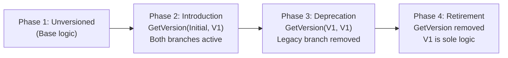

# Temporal Workflow Versioning Strategy

## 1. Overview and Core Determinism Guarantees

Temporal workflows execute deterministically: during worker recovery, worker deployment restarts, or event polling, Temporal replays past execution history from the beginning. Every decision, timer, activity scheduling, and child workflow invocation must occur in the exact same sequence with identical parameters.

If workflow logic is modified in code without version gating (for example, inserting a new activity, reordering execution steps, changing timer durations, or modifying condition branches), replaying an in-flight workflow will fail with a non-deterministic replay error:

```text
[TMPRL1100] lookup failed for scheduledEventID to activityID ...
workflow panic: nondeterministic error
```

In the Gargi Flow orchestrator, reactive workflows (`GraphExecutionWorkflow`) execute complex graph-based computational DAGs, entity extraction pipelines, and external signal listeners. Executions can remain active across hours or days. Therefore, zero-downtime rolling deployments and deterministic backward compatibility are mandatory operational requirements.

We adopt a two-tier versioning architecture:
1. **In-Workflow Versioning (`workflow.GetVersion`)** for granular in-code logic changes, bug fixes, and feature additions within an existing workflow type.
2. **Worker Versioning (Worker Build IDs & Version Sets)** for fleet-level routing, major orchestrator rewrites, blue/green deployments, and canary releases.

---

## 2. In-Workflow Versioning via `workflow.GetVersion`

### 2.1 Versioning Primitives and Helpers

The Gargi orchestrator provides helper functions wrapping the Temporal SDK:

```go
// GetWorkflowVersion wraps workflow.GetVersion with Gargi conventions.
func GetWorkflowVersion(
    ctx workflow.Context,
    changeID string,
    minSupported, maxSupported workflow.Version,
) workflow.Version

// IsVersionAtLeast checks if the current execution has negotiated at least the required version.
func IsVersionAtLeast(
    ctx workflow.Context,
    changeID string,
    minSupported, maxSupported, required workflow.Version,
) bool
```

Standard identifiers and version constants defined in `internal/orchestrator/version.go`:
- `ChangeIDGraphWorkflowVersion = "gargi-graph-workflow-version"`: Change ID for `GraphExecutionWorkflow` evolution.
- `ChangeIDPayloadValidation = "gargi-payload-validation"`: Change ID for payload validation gating.
- `VersionInitial = workflow.DefaultVersion` (`-1`): Baseline workflow version before explicit versioning was added.
- `VersionV1 = 1`: First milestone version.
- `VersionV2 = 2`: Subsequent milestone version.

### 2.2 How `workflow.GetVersion` Works Under the Hood

1. **Initial Run of New Workflow:**
   When a new workflow execution encounters `workflow.GetVersion(ctx, changeID, minSupported, maxSupported)`:
   - Temporal records `maxSupported` as a marker event (`EVENT_TYPE_MARKER_RECORDED`) in the execution history.
   - Temporal records `TemporalChangeVersion` in search attributes.
   - The function returns `maxSupported`.

2. **Replay of Execution Started Before the Change:**
   When replaying an execution that ran before the version marker was added:
   - History contains no marker for `changeID`.
   - Temporal assigns the execution `workflow.DefaultVersion` (`-1` / `VersionInitial`).
   - If `VersionInitial >= minSupported`, the function returns `VersionInitial`.
   - The workflow executes the legacy code branch, matching the recorded history.

3. **Replay of Execution Started After the Change:**
   When replaying an execution that started after the marker was added:
   - History contains the marker with the version recorded when the workflow first ran.
   - The function returns the recorded version without appending new markers.
   - The workflow executes the new code branch, preserving determinism.

### 2.3 Implementation Pattern

When adding a feature (e.g. payload size check) to `GraphExecutionWorkflow`:

```go
wfVersion := orchestrator.GetWorkflowVersion(
    ctx,
    orchestrator.ChangeIDGraphWorkflowVersion,
    orchestrator.VersionInitial,
    orchestrator.VersionV1,
)

if wfVersion >= orchestrator.VersionV1 {
    // New feature: validate payload sizes
    checkPayloadSize(ctx, "input_definition", input.Definition)
}
// Legacy executions skip this check, ensuring identical history replay
```

---

## 3. Worker Build IDs and Canary Deployment Routing

While `workflow.GetVersion` is ideal for localized code changes, Worker Build IDs operate at the worker fleet deployment level.

### 3.1 Worker Configuration

Worker build ID configuration is driven by `config.TemporalConfig`:

```yaml
temporal:
  host_port: "localhost:7233"
  namespace: "default"
  task_queue: "gargi_tasks"
  build_id: "gargi-flow-v1.2.0"
  use_build_id_for_versioning: true
```

Or via environment variables:
```bash
GARGI_TEMPORAL_BUILD_ID="gargi-flow-v1.2.0"
GARGI_TEMPORAL_USE_BUILD_ID_FOR_VERSIONING="true"
```

The `WorkerManager` in `internal/orchestrator/worker.go` configures `worker.Options`:
```go
workerOpts := worker.Options{
    BuildID:                 cfg.BuildID,
    UseBuildIDForVersioning: cfg.UseBuildIDForVersioning,
}
```

### 3.2 Routing Guarantees and Version Sets

Temporal Server organizes worker build IDs into **Version Sets**:
- **Default Build ID:** The build ID designated to receive newly scheduled workflows and unversioned tasks.
- **Compatible Build IDs:** Historical build IDs that can safely process existing workflow executions without non-determinism.

### 3.3 Canary Deployments

To execute canary deployments with Worker Build IDs:
1. **Deploy Canary Workers:** Deploy workers with the new `BuildID` (e.g. `gargi-flow-v1.3.0`) and `UseBuildIDForVersioning: true`.
2. **Add to Version Set:** Using the Temporal CLI or client management APIs, add the new build ID to the version set without immediately promoting it as default:
   ```bash
   temporal task-queue versioning update-build-id-compatibility \
     --task-queue gargi_tasks \
     --add-new-build-id gargi-flow-v1.3.0 \
     --existing-compatible-build-id gargi-flow-v1.2.0
   ```
3. **Validate:** Monitor execution metrics, workflow completion rates, and error logs from canary instances.
4. **Promote as Default:** Promote the validated build ID to default for new workflows:
   ```bash
   temporal task-queue versioning update-build-id-compatibility \
     --task-queue gargi_tasks \
     --promote-build-id gargi-flow-v1.3.0
   ```
5. **Drain & Retire:** Once in-flight executions on older build IDs have terminated, safely terminate older worker instances.

---

## 4. Deprecating Older Versions Safely

Keeping legacy version branches indefinitely clutters code. However, removing a version check prematurely causes running executions on older branches to panic when replayed.

### 4.1 The Four-Phase Version Deprecation Lifecycle



#### Phase 1: Unversioned Code
The workflow logic runs without version checks. All existing executions are recorded as unversioned (`VersionInitial`).

#### Phase 2: Active Evolution (Introduction)
When introducing breaking or altered behavior:
```go
v := orchestrator.GetWorkflowVersion(ctx, ChangeID, orchestrator.VersionInitial, orchestrator.VersionV1)
if v == orchestrator.VersionInitial {
    // Legacy branch
} else {
    // New branch
}
```
Deploy this code. Both legacy in-flight workflows and newly scheduled workflows run safely.

#### Phase 3: Deprecation of Legacy Versions
Once all workflows started before Phase 2 have finished:
1. Verify with Temporal Search Attributes that no open executions exist on `VersionInitial`:
   ```bash
   temporal workflow list --query 'TemporalChangeVersion NOT LIKE "%gargi-graph-workflow-version-1%" AND ExecutionStatus = "Running"'
   ```
2. When count is zero, bump `minSupportedVersion`:
   ```go
   v := orchestrator.GetWorkflowVersion(ctx, ChangeID, orchestrator.VersionV1, orchestrator.VersionV1)
   // Remove legacy branch code entirely!
   ```
3. Deploy this update. Any unexpected historical replay of pre-V1 will fail deterministically rather than executing obsolete logic.

#### Phase 4: Final Retirement
When the workflow retention period (e.g. 30 days) has expired and no historical executions will ever be replayed by workers, the `GetWorkflowVersion` call can be removed completely.

---

## 5. Replay Testing and Determinism Verification

### 5.1 Replay Testing Architecture

Unit tests cannot always foresee how Temporal's replayer processes recorded history events. To guarantee deterministic safety, the repository includes replay tests in `internal/orchestrator/replay_test.go` utilizing `worker.WorkflowReplayer`.

Recorded execution histories are stored in `internal/orchestrator/testdata/`:
- `graph_workflow_unversioned_history.json`: Baseline unversioned execution history.
- `recorded_history_v1.json`: Execution history with `ChangeIDGraphWorkflowVersion` recorded at version 1.
- `graph_workflow_v1_history.json`: Reference execution history with version 1 marker.

### 5.2 Test Implementation

Replay tests register the workflow definition and replay against recorded JSON history files:

```go
func TestWorkflowReplay_RecordedHistoryV1(t *testing.T) {
    historyPath := filepath.Join("testdata", "recorded_history_v1.json")

    replayer := worker.NewWorkflowReplayer()
    replayer.RegisterWorkflow(orchestrator.GraphExecutionWorkflow)

    err := replayer.ReplayWorkflowHistoryFromJSONFile(nil, historyPath)
    require.NoError(t, err, "recorded v1 historical execution must replay deterministically without errors")
}
```

### 5.3 Non-Determinism Regression Tests

To verify that the test suite catches illegal modifications, `replay_test.go` includes tests that simulate unversioned changes:

```go
func IncompatibleWorkflow(ctx workflow.Context, input orchestrator.GraphWorkflowInput) (*orchestrator.GraphWorkflowResult, error) {
    _ = workflow.Sleep(ctx, 10*time.Second) // Unversioned injected command
    return orchestrator.GraphExecutionWorkflow(ctx, input)
}

func TestWorkflowReplay_IncompatibleChangeDetectsNonDeterminism(t *testing.T) {
    historyPath := filepath.Join("testdata", "graph_workflow_unversioned_history.json")

    replayer := worker.NewWorkflowReplayer()
    replayer.RegisterWorkflowWithOptions(IncompatibleWorkflow, workflow.RegisterOptions{
        Name: orchestrator.GraphExecutionWorkflowName,
    })

    err := replayer.ReplayWorkflowHistoryFromJSONFile(nil, historyPath)
    require.Error(t, err)
    require.Contains(t, err.Error(), "TMPRL1100")
}
```

### 5.4 How to Capture History for New Workflow Versions

When a new workflow version or new workflow topology is added:
1. Run a sample workflow execution in the local development environment or Temporal test environment.
2. Export the execution history:
   ```bash
   temporal workflow show \
     --workflow-id <workflow-id> \
     --run-id <run-id> \
     --output json > internal/orchestrator/testdata/recorded_history_v<N>.json
   ```
3. Add a corresponding test in `internal/orchestrator/replay_test.go`.
4. Run `go test -v -race ./internal/orchestrator/...` to verify replay passes.
